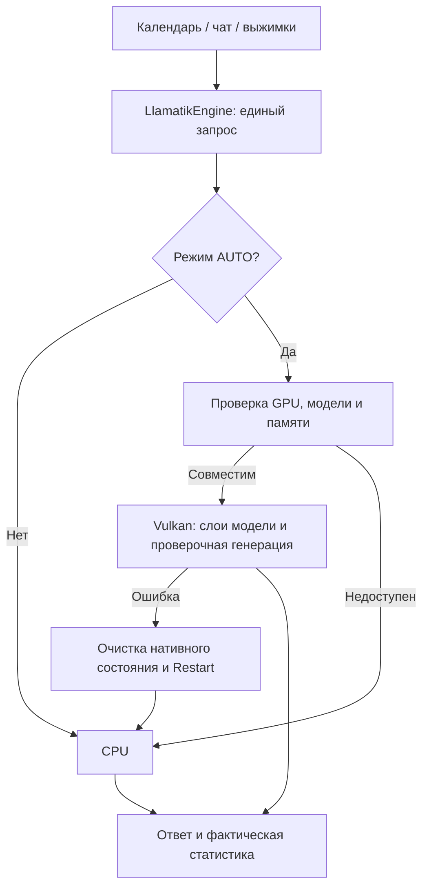

# Автоматический GPU / CPU для локальной GGUF-модели

Дата: 2026-11-12.

## Поведение

В профилях «Календарь» и «Чат и выжимки» сохраняется `ComputeMode`:

- `AUTO` — проверить Vulkan-устройство, совместимость модели и память; выбрать число слоёв для GPU.
- `CPU` — использовать CPU без загрузки Vulkan-плагина для этого запроса.

Отсутствующее или повреждённое значение настройки читается как `AUTO`. Старое
`gpuLayers = 0` не отключает новый автоматический режим. Положительное старое
значение остаётся верхней границей числа выгружаемых слоёв.

Раздел **Настройки → Вычисления AI** содержит выбор режима отдельно для двух
профилей и сведения о последнем нативном запуске: модель, запрошенный режим,
фактический вычислитель, устройство, число слоёв, причина перехода на CPU,
время подготовки, время до первого токена и скорость обработки/генерации.
Фактический GPU подтверждается сообщением движка о выгрузке слоёв, а не
сохранённой настройкой. Частичная выгрузка обозначается «GPU + CPU · Vulkan».

`AUTO` выбирает совместимый GPU по возможности выполнения и памяти. Сравнение
скорости CPU и GPU перед каждым запросом не выполняется; ускорение на каждом
устройстве не гарантируется.

Предварительно проверяется версия Vulkan самого GPU, а не только Android loader:
требуются Vulkan 1.2 и `storageBuffer16BitAccess`. Проверка выполняется до
регистрации backend в GGML. Несовместимый драйвер не участвует в последующей
CPU-загрузке. Разные движки, включая LiteRT/OpenCL, имеют другие требования;
работа стороннего приложения на GPU не доказывает совместимость GGUF/Vulkan.

## Архитектура



Нативный движок работает в непубличном bound-сервисе `LlamaWorkerService`
в отдельном процессе `:llm`. Интерфейс, Room, DataStore и голосовые компоненты
остаются в своих прежних владельцах. Передача длинного запроса использует
read-only `SharedMemory`, чтобы не упираться в размер Binder-транзакции.
Синхронный обратный вызов потока ограничивает накопление непрочитанных токенов.

Глобальный mutex сериализует обращения нескольких экземпляров движка к одному
рабочему процессу. Каждый runtime имеет свой идентификатор владельца: очистка
предыдущего владельца не должна освобождать уже загруженную новую модель.
Доступность allocation проверяет владельца и живой Binder.

## Переход на CPU и отмена

При ошибке загрузки/выполнения на GPU допускается один повтор того же запроса
на CPU. Параметры и путь модели фиксируются для запроса. После ошибки драйвера
рабочий процесс пересоздаётся: освобождения одной модели недостаточно, если
глобальное состояние GPU backend осталось частично инициализированным.
Перед повтором заново проверяется возможность CPU-выделения.

Поток `GenerationEvent.Restart` очищает незавершённый ответ. Текст CPU заменяет
частичный ответ GPU в той же записи сообщения. Сборщики JSON календаря и
выжимок тоже сбрасывают незавершённый результат; календарные команды выполняются
после получения законченного ответа. `onReady` передаётся один раз.

Отмена пользователя не запускает CPU-повтор. Сигнал отмены не ждёт блокировки
долгого нативного вызова. Watchdog завершает только свой рабочий процесс, если
после отмены прошло 10 секунд без возврата или GPU-операция не отвечает 5 минут.
Время ожидания подключения сервиса — 15 секунд. Следующий запрос подключается
к новому процессу и заново создаёт нативное состояние.

Устойчивые ошибки совместимости сохраняются с ключом: ревизия runtime,
время обновления APK, Android build fingerprint, идентичность драйвера/устройства,
путь, размер и время изменения GGUF. Ошибки выделения памяти и завершение
процесса из-за low memory не сохраняются как постоянный запрет модели.

## Память

GGUF-reader читает метаданные и описания тензоров без материализации весов.
Размер GPU-копии оценивается по фактическим смещениям тензоров последних
выгружаемых блоков, с общими весами при полной выгрузке. При неизвестном
расположении используется консервативная оценка полной копии.

Выбор числа слоёв учитывает общий RAM-бюджет, рабочие буферы, минимальный контекст
конкретного запроса и свободную память Vulkan с запасом. Память существующего
allocation учитывается по private dirty рабочего процесса; чистые mmap-страницы
не прибавляются повторно к доступной RAM. Это оценка, а не гарантия выделения:
фактическая ошибка GPU обрабатывается переходом на CPU.

## Нативная сборка

Используется существующий `com.llamatik:library:1.10.1` и один общий registry
GGML. Дополнительно собирается только динамический `libggml-vulkan.so`;
CPU, GGML base и llama берутся из того же AAR. Ревизия GGML взята из gitlink
`llama.cpp` официального релиза Llamatik `v1.10.1`. Аудированный `llama.h`
совпадает с этим исходником. Публичные GGML-заголовки синхронизированы с ним и
проверяются CMake перед сборкой плагина.

Закреплённые исходники и SHA-256 архивов:

| Компонент | Ревизия | SHA-256 |
| --- | --- | --- |
| llama.cpp / GGML | `961e9a3e46ca4cf7e6e86cfceb5b5e32084bf5f0` | `e30caabcde296788d7113f8e5985282753825bfa75d1ae8f3db419a803e45ea1` |
| SPIRV-Headers | `vulkan-sdk-1.4.321.0` | `5bbea925663d4cd2bab23efad53874f2718248a73dcaf9dd21dff8cb48e602fc` |
| Vulkan-Headers | `vulkan-sdk-1.4.321.0` | `17f8ff30fd79fb7531efcb7c78c02c17a595208d482a150f06836b0ca97ef8f2` |

Первый запуск CMake загружает архивы; кеш находится в `build/llama-gpu`.
Извлечение завершается один раз в каталоге с идентификатором SHA-256 и
сериализуется файловой блокировкой для одновременной сборки ABI. Другие ABI
используют завершённый каталог, не удаляя исходники работающего компилятора.

В сборочном адаптере исправлены четыре выражения upstream для 32-битных
Vulkan handles: три вывода диагностических адресов и аргументы `copyBuffer`.
Ядра шейдеров и алгоритмы вычисления не заменяются.

Локальный Windows build использует NDK `28.2.13676358`, CMake `3.22.1`, NDK
`glslc` и установленный Visual Studio C++ Build Tools для host-генератора.
Лицензии дополнительных компонентов включены в `assets/licenses`.

Поддерживаемая приложением нижняя граница остаётся Android 11 / API 30.
Наличие Android 11 само по себе не означает поддержку данного Vulkan backend.

## Проверки

Unit-тесты проверяют выбор GPU/CPU, принудительный CPU без GPU-пробы,
единственный CPU-повтор, замену частичного ответа, отмену без повтора,
отказ GPU по памяти, поток длиннее ёмкости канала, чтение размеров тензоров
и миграцию/сохранение режима по профилям.

Запуск:

```powershell
.\gradlew.bat :app:assembleDebug :app:assembleDebugAndroidTest :app:testDebugUnitTest
adb shell am instrument -w -r -e gpuModel calendar-assistant-v12.67-Qwen3-0.6B-Q8_0.gguf -e class com.example.aiassistent1.data.engine.GpuAutomaticInstrumentedTest com.example.aiassistent1.test/androidx.test.runner.AndroidJUnitRunner
adb shell am instrument -w -r -e class com.example.aiassistent1.presentation.ui.InferenceSettingsInstrumentedTest com.example.aiassistent1.test/androidx.test.runner.AndroidJUnitRunner
```

Опциональный device-тест выполняет запросы `CALENDAR`, `CHAT`, `SUMMARY` в AUTO
и CPU на уже установленной модели, а затем проверяет повторную генерацию после
завершения собственного `:llm` процесса. Историю чатов и выбранные настройки
модели тест не изменяет. Отчёт сохраняется в `cache/gpu-auto-device.json`.

Результаты 2026-11-12:

| Проверка | Результат |
| --- | --- |
| Debug APK + AndroidTest APK, четыре ABI | Сборка успешна |
| Unit-тесты | 853 всего; 852 выполнено, 1 пропущен; 0 ошибок |
| Vulkan-плагин в APK | `arm64-v8a`, `armeabi-v7a`, `x86`, `x86_64` |
| 64-битные ELF и размещение `.so` в APK | 40 библиотек проверены на выравнивание 16 KiB; ошибок нет |
| Redmi Note 11E Pro, Android 13, Adreno 619 | AUTO выбирает CPU: GPU сообщает Vulkan 1.1.128, backend требует 1.2 |
| `CALENDAR`, `CHAT`, `SUMMARY` в AUTO и CPU | 6 генераций завершены |
| CPU после завершения своего `:llm` | Повторное подключение и седьмая генерация успешны |
| Отдельный пункт настроек | UI-тест открытия, сведений и сохранения CPU прошёл |

Проверочная модель: `calendar-assistant-v12.67-Qwen3-0.6B-Q8_0.gguf`.
Фактические измерения сохранены в
[`validation/LLM_GPU_CPU_REDMI_2026_11_12.json`](validation/LLM_GPU_CPU_REDMI_2026_11_12.json).
Это короткий проверочный запрос, а не контролируемый сравнительный бенчмарк.

Выполнение генерации именно на GPU на совместимом физическом устройстве
с Vulkan 1.2 пока не проверено. Mali, остальные модели GPU, Android 11 и
устройство с реальными страницами памяти 16 KiB физически не проверялись.
Сборка ABI и проверка ELF не заменяют такие испытания.

На проверенном Redmi нельзя обещать GPU для GGUF через этот Vulkan backend.
Поддержка другого backend, например OpenCL, требует отдельной реализации и
проверки конкретного драйвера и модели.
